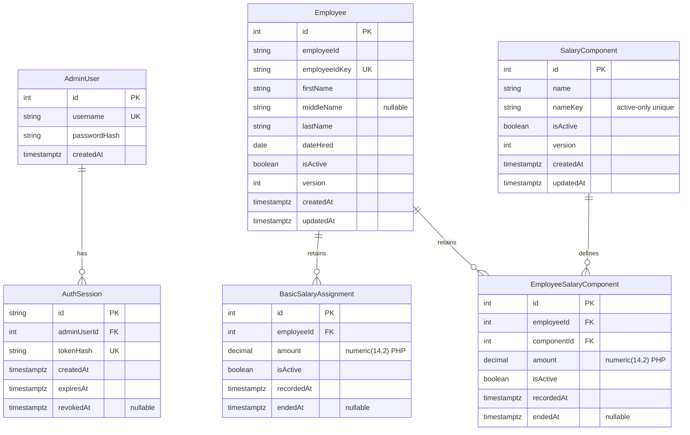

# Employee Salary Management ERD

## Relational Constraints and Invariants
- AdminUser: Unique username, bcrypt password hash.
- AuthSession: Hashed verifier (`tokenHash`) stored in DB; raw 32-byte secret in HttpOnly cookie. Fixed 8-hour expiry from creation (`expiresAt = createdAt + 8h`). Revoked on logout (`revokedAt`).
- Partial unique indexes:
  - `BasicSalaryAssignment(employeeId)` WHERE isActive = true (or `endedAt IS NULL`)
  - `SalaryComponent(nameKey)` WHERE isActive = true (or `endedAt IS NULL`)
  - `EmployeeSalaryComponent(employeeId, componentId)` WHERE isActive = true (or `endedAt IS NULL`)
- Monetary precision: PostgreSQL `numeric(14,2)` for exact decimal representation (max PHP 999,999,999,999.99).
- Hire date: PostgreSQL `date`.
