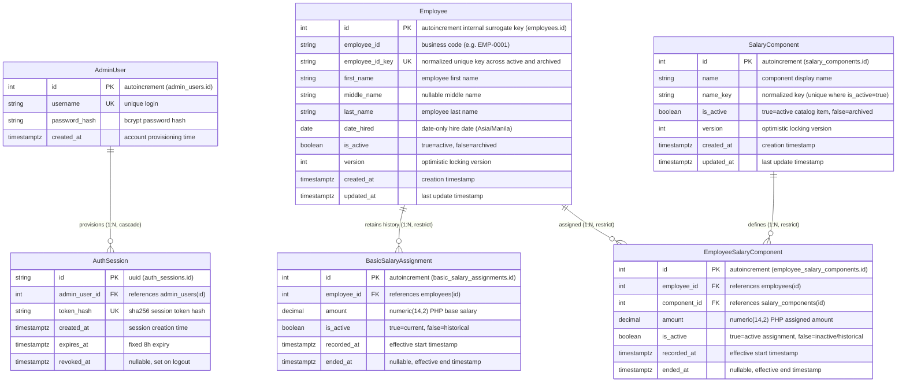

# Employee Salary Management — Database Entity Relationship Documentation (ERD)

**Status:** Approved Baseline Relational Design (Partially Implemented Across Feature Branches)  
**Target Database:** Neon Serverless PostgreSQL (`aws-ap-southeast-1` / Singapore)  
**ORM / Migration Engine:** Prisma 7.10.1 (`@prisma/client` + `@prisma/adapter-pg`)  
**Associated Diagram Files:**
- Editable XML Diagram: [erd.drawio](erd.drawio)
- High-Resolution PNG Preview: [erd.png](erd.png)
- Scalable Vector SVG Preview: [erd.svg](erd.svg)

---

## 1. Executive Summary & Baseline Model Scope

This document details the reviewable 6-table relational database architecture for the **Employee Onboarding and Salary Management** application. The baseline data model satisfies four required business modules (Employee Onboarding & Directory, Basic Salary Assignment & History, Salary Component Catalog, and Employee Component Assignment & Calculation) plus secure administrative access control with server-revocable sessions.

### Baseline Tables (6 Total)
1. **`admin_users`** (`AdminUser`) — System administrator credentials with bcrypt password hashing.
2. **`auth_sessions`** (`AuthSession`) — Server-side revocable 8-hour sessions tracking SHA-256 token hashes.
3. **`employees`** (`Employee`) — Core employee registry with normalized business IDs and date-only hiring.
4. **`basic_salary_assignments`** (`BasicSalaryAssignment`) — Historical and active base salary records in PHP.
5. **`salary_components`** (`SalaryComponent`) — Shared reusable additive salary component catalog with nonnegative amounts.
6. **`employee_salary_components`** (`EmployeeSalaryComponent`) — Junction entity binding employees to catalog components with custom amounts.

---

## 2. Implemented vs. Planned Status Matrix

The codebase utilizes modular feature development across targeted tickets. The table below outlines the implementation status across repository commits:

| Table Name (PostgreSQL) | Model Name (Prisma) | Associated Ticket | Implementation Status | Commit SHA / Branch | Key Constraints Implemented |
| :--- | :--- | :--- | :--- | :--- | :--- |
| **`admin_users`** | `AdminUser` | Ticket 01 (Auth) | **Implemented** | `c670727` (`main`) | `username` UNIQUE |
| **`auth_sessions`** | `AuthSession` | Ticket 01 (Auth) | **Implemented** | `c670727` (`main`) | `token_hash` UNIQUE, FK -> `admin_users(id)` ON DELETE CASCADE |
| **`employees`** | `Employee` | Ticket 02 (Employees) | **Implemented** | `fa08467` (`main`) | `employee_id_key` UNIQUE, date-only `date_hired`, `version` |
| **`basic_salary_assignments`** | `BasicSalaryAssignment` | Ticket 03 (Basic Salary) | **Implemented** | `d4073fa` (`PSergio984/salary-basic-history`) | Partial UNIQUE on `employee_id` WHERE `is_active = true`, FK -> `employees(id)` ON DELETE RESTRICT |
| **`salary_components`** | `SalaryComponent` | Ticket 04 (Catalog) | **Implemented** | `34f0fe5` (`PSergio984/salary-component-catalog`) | Partial UNIQUE on `name_key` WHERE `is_active = true`, `version` |
| **`employee_salary_components`** | `EmployeeSalaryComponent` | Ticket 05 (Component Assignment) | **Planned (Not Implemented)** | Approved Baseline Design (`.scratch/salary-management/erd.md`) | Planned Partial UNIQUE on `(employee_id, component_id)` WHERE `is_active = true`, FKs ON DELETE RESTRICT |

### Branch Divergence & Reconciliation Note
- **Parallel Feature Branches:** Ticket 03 (`PSergio984/salary-basic-history`, commit `d4073fa`) and Ticket 04 (`PSergio984/salary-component-catalog`, commit `34f0fe5`) branched independently to implement basic salary history and shared component catalog respectively.
- **Migration Continuity:** In `d4073fa`, migration `20261113045133_add_basic_salary_assignment` introduces `basic_salary_assignments`. In `34f0fe5`, migration `20261113045500_salary_component_catalog` introduces `salary_components`.
- **Planned Unification:** Once Tickets 03 and 04 land in `main`, Ticket 05 will implement the junction table `employee_salary_components` referencing both `employees(id)` and `salary_components(id)`.

---

## 3. Complete 6-Table Relational Schema Definition

### 3.1. `admin_users`
Stores authenticated administrator accounts. Access is provisioned via seed script; no public registration is supported.

- **Prisma Model:** `AdminUser`
- **SQL Table:** `admin_users`

| Column | PostgreSQL Type | Prisma Type | Nullable | Default | Description |
| :--- | :--- | :--- | :--- | :--- | :--- |
| `id` | `SERIAL` (`INTEGER`) | `Int` | No | `autoincrement()` | Primary Key (Surrogate ID) |
| `username` | `TEXT` | `String` | No | — | Unique login username |
| `password_hash` | `TEXT` | `String` | No | — | Bcrypt-hashed administrator password |
| `created_at` | `TIMESTAMPTZ(3)` | `DateTime` | No | `now()` | Account provisioning timestamp |

- **Indexes & Constraints:**
  - `admin_users_pkey`: `PRIMARY KEY ("id")`
  - `admin_users_username_key`: `UNIQUE ("username")`
- **Relations:**
  - 1-to-many with `auth_sessions` (`onDelete: Cascade`)

---

### 3.2. `auth_sessions`
Maintains server-side session state for revocable authentication. The browser holds an opaque 32-byte secret in an `HttpOnly` cookie; only the SHA-256 hash is persisted.

- **Prisma Model:** `AuthSession`
- **SQL Table:** `auth_sessions`

| Column | PostgreSQL Type | Prisma Type | Nullable | Default | Description |
| :--- | :--- | :--- | :--- | :--- | :--- |
| `id` | `TEXT` / `UUID` | `String` | No | `uuid()` | Primary Key (Session identifier) |
| `admin_user_id` | `INTEGER` | `Int` | No | — | Foreign Key referencing `admin_users(id)` |
| `token_hash` | `TEXT` | `String` | No | — | SHA-256 hash of the 32-byte session token |
| `created_at` | `TIMESTAMPTZ(3)` | `DateTime` | No | `now()` | Session creation timestamp |
| `expires_at` | `TIMESTAMPTZ(3)` | `DateTime` | No | — | Session expiration timestamp (`created_at + 8 hours`) |
| `revoked_at` | `TIMESTAMPTZ(3)` | `DateTime` | Yes | `NULL` | Explicit logout timestamp; `NULL` if active |

- **Indexes & Constraints:**
  - `auth_sessions_pkey`: `PRIMARY KEY ("id")`
  - `auth_sessions_token_hash_key`: `UNIQUE ("token_hash")`
  - `auth_sessions_admin_user_id_idx`: `INDEX ("admin_user_id")`
  - `auth_sessions_admin_user_id_fkey`: `FOREIGN KEY ("admin_user_id") REFERENCES "admin_users"("id") ON DELETE CASCADE ON UPDATE CASCADE`

---

### 3.3. `employees`
Core employee master directory entity. Business IDs are distinct from internal primary keys to allow business label corrections without breaking relations.

- **Prisma Model:** `Employee`
- **SQL Table:** `employees`

| Column | PostgreSQL Type | Prisma Type | Nullable | Default | Description |
| :--- | :--- | :--- | :--- | :--- | :--- |
| `id` | `SERIAL` (`INTEGER`) | `Int` | No | `autoincrement()` | Primary Key (Stable internal surrogate ID) |
| `employee_id` | `TEXT` | `String` | No | — | Business employee code (e.g., `"EMP-0001"`) |
| `employee_id_key`| `TEXT` | `String` | No | — | Normalized unique key (trimmed, lowercased) |
| `first_name` | `TEXT` | `String` | No | — | Employee first name |
| `middle_name` | `TEXT` | `String` | Yes | `NULL` | Optional middle name |
| `last_name` | `TEXT` | `String` | No | — | Employee last name |
| `date_hired` | `DATE` | `DateTime` | No | — | Date of hire (PostgreSQL date-only, Asia/Manila) |
| `is_active` | `BOOLEAN` | `Boolean` | No | `true` | `true` = Active, `false` = Archived |
| `version` | `INTEGER` | `Int` | No | `1` | Optimistic locking version number |
| `created_at` | `TIMESTAMPTZ(3)` | `DateTime` | No | `now()` | Record creation timestamp |
| `updated_at` | `TIMESTAMPTZ(3)` | `DateTime` | No | — | Record modification timestamp |

- **Indexes & Constraints:**
  - `employees_pkey`: `PRIMARY KEY ("id")`
  - `employees_employee_id_key_key`: `UNIQUE ("employee_id_key")` (Enforces uniqueness across BOTH active and archived employees)
  - `employees_last_name_first_name_idx`: `INDEX ("last_name", "first_name")`
- **Relations:**
  - 1-to-many with `basic_salary_assignments` (`onDelete: Restrict`)
  - 1-to-many with `employee_salary_components` (`onDelete: Restrict`)

---

### 3.4. `basic_salary_assignments`
Maintains monthly basic salary history for employees in Philippine Pesos (PHP). Updates retire the current active row and create a new row atomically.

- **Prisma Model:** `BasicSalaryAssignment`
- **SQL Table:** `basic_salary_assignments`

| Column | PostgreSQL Type | Prisma Type | Nullable | Default | Description |
| :--- | :--- | :--- | :--- | :--- | :--- |
| `id` | `SERIAL` (`INTEGER`) | `Int` | No | `autoincrement()` | Primary Key |
| `employee_id` | `INTEGER` | `Int` | No | — | Foreign Key referencing `employees(id)` |
| `amount` | `DECIMAL(14,2)` | `Decimal` | No | — | Monthly base pay in PHP (`0.00` to `999,999,999,999.99`) |
| `is_active` | `BOOLEAN` | `Boolean` | No | `true` | `true` = Current active rate, `false` = Historical |
| `recorded_at` | `TIMESTAMPTZ(3)` | `DateTime` | No | `now()` | Timestamp when assignment became effective |
| `ended_at` | `TIMESTAMPTZ(3)` | `DateTime` | Yes | `NULL` | Timestamp when superseded; `NULL` while active |

- **Indexes & Constraints:**
  - `basic_salary_assignments_pkey`: `PRIMARY KEY ("id")`
  - `basic_salary_assignments_employee_id_idx`: `INDEX ("employee_id")`
  - `basic_salary_active_employee_idx`: `UNIQUE ("employee_id") WHERE "is_active" = true` (Partial unique index: exactly one active basic salary per employee)
  - `basic_salary_assignments_employee_id_fkey`: `FOREIGN KEY ("employee_id") REFERENCES "employees"("id") ON DELETE RESTRICT ON UPDATE CASCADE`

---

### 3.5. `salary_components`
Reusable catalog of salary component definitions (e.g., Housing Allowance, Healthcare, Meal Subsidy). Components can be globally archived without physical deletion.

- **Prisma Model:** `SalaryComponent`
- **SQL Table:** `salary_components`

| Column | PostgreSQL Type | Prisma Type | Nullable | Default | Description |
| :--- | :--- | :--- | :--- | :--- | :--- |
| `id` | `SERIAL` (`INTEGER`) | `Int` | No | `autoincrement()` | Primary Key |
| `name` | `TEXT` | `String` | No | — | Display component name |
| `name_key` | `TEXT` | `String` | No | — | Normalized catalog name key (trimmed, lowercased) |
| `is_active` | `BOOLEAN` | `Boolean` | No | `true` | `true` = Active catalog item, `false` = Archived |
| `version` | `INTEGER` | `Int` | No | `1` | Optimistic locking version number |
| `created_at` | `TIMESTAMPTZ(3)` | `DateTime` | No | `now()` | Creation timestamp |
| `updated_at` | `TIMESTAMPTZ(3)` | `DateTime` | No | — | Last update timestamp |

- **Indexes & Constraints:**
  - `salary_components_pkey`: `PRIMARY KEY ("id")`
  - `salary_components_name_key_idx`: `INDEX ("name_key")`
  - `salary_components_name_key_active_idx`: `UNIQUE ("name_key") WHERE "is_active" = true` (Partial unique index: active component names must be unique; archived names may be reused)
- **Relations:**
  - 1-to-many with `employee_salary_components` (`onDelete: Restrict`)

---

### 3.6. `employee_salary_components` (Planned Baseline Entity)
Junction entity attaching active or historical salary components to specific employees with employee-specific amounts in PHP.

- **Prisma Model (Planned):** `EmployeeSalaryComponent`
- **SQL Table (Planned):** `employee_salary_components`

| Column | PostgreSQL Type | Prisma Type | Nullable | Default | Description |
| :--- | :--- | :--- | :--- | :--- | :--- |
| `id` | `SERIAL` (`INTEGER`) | `Int` | No | `autoincrement()` | Primary Key |
| `employee_id` | `INTEGER` | `Int` | No | — | Foreign Key referencing `employees(id)` |
| `component_id` | `INTEGER` | `Int` | No | — | Foreign Key referencing `salary_components(id)` |
| `amount` | `DECIMAL(14,2)` | `Decimal` | No | — | Specific component amount in PHP |
| `is_active` | `BOOLEAN` | `Boolean` | No | `true` | `true` = Currently contributing, `false` = Inactive/Past |
| `recorded_at` | `TIMESTAMPTZ(3)` | `DateTime` | No | `now()` | Timestamp when assigned |
| `ended_at` | `TIMESTAMPTZ(3)` | `DateTime` | Yes | `NULL` | Timestamp when removed/superseded; `NULL` while active |

- **Indexes & Constraints (Planned):**
  - `employee_salary_components_pkey`: `PRIMARY KEY ("id")`
  - `employee_salary_components_employee_id_idx`: `INDEX ("employee_id")`
  - `employee_salary_components_component_id_idx`: `INDEX ("component_id")`
  - `employee_salary_components_active_pair_idx`: `UNIQUE ("employee_id", "component_id") WHERE "is_active" = true` (Partial unique index: at most one active assignment per employee/component pair; historical rows preserved)
  - `employee_salary_components_employee_id_fkey`: `FOREIGN KEY ("employee_id") REFERENCES "employees"("id") ON DELETE RESTRICT ON UPDATE CASCADE`
  - `employee_salary_components_component_id_fkey`: `FOREIGN KEY ("component_id") REFERENCES "salary_components"("id") ON DELETE RESTRICT ON UPDATE CASCADE`

---

## 4. Partial Unique Constraints & Indexing Strategy

PostgreSQL partial unique indexes (`CREATE UNIQUE INDEX ... WHERE ...`) enforce critical business rules while allowing full history preservation:

```sql
-- 1. Exactly one active basic salary per employee:
CREATE UNIQUE INDEX "basic_salary_active_employee_idx" 
ON "basic_salary_assignments"("employee_id") 
WHERE "is_active" = true;

-- 2. Unique normalized active component catalog names (archived names can be reused):
CREATE UNIQUE INDEX "salary_components_name_key_active_idx" 
ON "salary_components"("name_key") 
WHERE "is_active" = true;

-- 3. At most one active assignment per employee and component pair (historical records allowed):
CREATE UNIQUE INDEX "employee_salary_components_active_pair_idx" 
ON "employee_salary_components"("employee_id", "component_id") 
WHERE "is_active" = true;
```

### Contrast: Global Uniqueness vs. Partial Uniqueness
- **Global Uniqueness (`employees.employee_id_key`):** Enforced across **both active and archived** employees. Archiving an employee does NOT release their business ID, preventing collisions and ambiguity.
- **Partial Uniqueness (`salary_components.name_key`):** Enforced **only on active** records (`WHERE is_active = true`). Archiving a catalog component retires its active status, allowing administrators to introduce a fresh component definition under the same name without corrupting historical references.
- **Partial Pair Uniqueness (`employee_salary_components`):** An employee can only have one active instance of a specific salary component at any given moment, but multiple historical instances (`is_active = false`) are preserved.

---

## 5. Architectural & Domain Invariants Explained

### 5.1. Stable Internal Employee Foreign Key
- **Design:** Foreign keys in child tables (`basic_salary_assignments.employee_id`, `employee_salary_components.employee_id`) link strictly to the auto-incrementing integer surrogate key `employees.id`, never to the user-entered business string `employees.employee_id`.
- **Rationale:** If an administrator corrects a typographical error in an employee code (e.g., from `"EMP-001"` to `"EMP-0001"`), the update modifies only `employees.employee_id` and `employees.employee_id_key`. All financial history, rate calculations, and past assignments remain firmly attached to `employees.id` without requiring cascading foreign key updates or risking relational orphanhood.

### 5.2. Reserved Normalized Identifier (`employee_id_key` and `name_key`)
- **Design:** Both `Employee` and `SalaryComponent` maintain dedicated normalized key columns populated prior to insertion/update. Normalization trims surrounding whitespace and applies case-folding (lowercasing), while preserving significant inner characters and leading zeros.
- **Rationale:** Case-insensitive comparisons and trailing space errors are blocked at the database level. For example, `"EMP-001"`, `" emp-001"`, and `"emp-001 "` map to the same `employee_id_key` (`"emp-001"`), triggering a predictable unique constraint violation. Display strings retain original user-entered casing and formatting in `employee_id` and `name`.

### 5.3. Retained History & Mutation Semantics
- **Design:** Salary and component assignment changes never overwrite historical rows. 
- **Atomic Transition:** When updating an employee's basic salary:
  1. The existing active row for the employee is marked `is_active = false` with `ended_at = CURRENT_TIMESTAMP`.
  2. A new row is inserted with the new `amount`, `is_active = true`, and `recorded_at = CURRENT_TIMESTAMP`.
  3. Both steps execute in a single serializable database transaction.
- **Zero-History No-Op:** If an update submits the identical amount as the current active record, the operation verifies state and returns successfully without creating a redundant history row.

### 5.4. Archive Without Delete
- **Design:** Business records (`employees`, `salary_components`) are never physically deleted (`DELETE FROM`). Instead, archival operations update `is_active = false` and bump the `version` number.
- **Relational Integrity:** Child foreign keys are declared with `ON DELETE RESTRICT`. Even if an erroneous physical delete command is attempted, PostgreSQL rejects it if historical assignment rows reference the parent. This protects the audit trail and labor compliance verification.

### 5.5. No Baseline Restore
- **Design:** The approved baseline specification explicitly treats archival as a permanent deactivation within baseline scope. There are no restore endpoints (`/restore`) or `isActive = true` modification paths.
- **Rationale:** Reactivating an archived employee or component introduces complex business conflicts (e.g., duplicate names created during the archive window, superseded rate schedules). Restoring is deferred as a follow-on enhancement after the verified baseline passes.

### 5.6. Auth Session Security: Hash Verifier vs. Raw Secret
- **Design:** The session authorization mechanism utilizes a 32-byte cryptographically secure random token generated at login.
- **Token Handling:**
  - **Client Browser:** Holds the raw 32-byte secret exclusively in an `HttpOnly`, `SameSite=Lax`, `Path=/api` secure cookie. JavaScript has no access to the token.
  - **Neon PostgreSQL DB:** Stores only the SHA-256 cryptographic hash in `auth_sessions.token_hash`.
  - **Verification:** Incoming API requests hash the cookie value and query the database for a matching `token_hash` where `revoked_at IS NULL` and `expires_at > CURRENT_TIMESTAMP`.
- **Security Guarantee:** Even if a database snapshot or log leak occurs, active browser sessions cannot be hijacked because the raw pre-image token cannot be reconstructed from the SHA-256 hash. Explicit logout sets `revoked_at = CURRENT_TIMESTAMP`.

---

## 6. Data Types & Precision Standards

| Domain | PostgreSQL Data Type | Application Type | Formatting / Precision Standards |
| :--- | :--- | :--- | :--- |
| **Monetary Amounts** | `NUMERIC(14,2)` / `DECIMAL(14,2)` | String (`"20000.00"`) | Stored in Philippine Pesos (PHP). Bounds: `0.00` to `999,999,999,999.99`. Nonnegative, finite, exact decimal arithmetic. Floating point types (`FLOAT`, `DOUBLE`) are strictly forbidden to prevent rounding errors. |
| **Hire Date** | `DATE` | String (`"YYYY-MM-DD"`) | Date-only calendar date without timezone offset. Validated server-side against today's date in Philippine Standard Time (`Asia/Manila`, UTC+8). Future hire dates are rejected. |
| **Audit & Validity Timestamps** | `TIMESTAMPTZ(3)` | ISO 8601 UTC String | Millisecond precision with timezone. Rendered in client UI formatted in Philippine Standard Time. |
| **Concurrency Version** | `INTEGER` | `number` | Incremented on record mutation for optimistic locking (`version`). |

---

## 7. Complete Mermaid Entity Relationship Diagram



### Cardinality & Notation Legend
- `||--o{` : One-to-zero-or-more relationship (Mandatory parent on the left, optional/multiple children on the right).
- **PK**: Primary Key (Surrogate integer identifier or UUID).
- **FK**: Foreign Key (References parent primary key with `ON DELETE RESTRICT` for financial data, `ON DELETE CASCADE` for auth sessions).
- **UK**: Unique Key (Enforced by PostgreSQL unique index).

---

## 8. Visual Diagrams & Rendering Verification

An editable diagram and standalone visual previews are provided:
- **Editable Source:** [`erd.drawio`](erd.drawio) (Open with `hediet.vscode-drawio` in VS Code or [draw.io](https://app.diagrams.net))
- **Direct Standalone PNG:** [`erd.png`](erd.png) (Exported via Draw.io desktop engine, viewable in any image viewer)
- **Direct Standalone SVG:** [`erd.svg`](erd.svg) (Lossless vector export, viewable directly in browsers)

### Systematic Quality & Layout Verification Notes
- **Plain Labels (No Raw HTML Leaks):** All table names, column definitions, data types, and constraints use clean plain text labels without inline HTML tags (`<b>`, `<span>`, `<br/>`), eliminating raw markup display bugs across draw.io renderers.
- **High-Contrast Canvas & Typography:** Canvas specifies explicit `background="#ffffff"` and solid table row fills (`#ffffff`) with dark `#111111` typography, ensuring perfect readability in both dark and light editor themes.
- **Generous Geometry & Spacing:** Table widths (440–480px) and row heights (30px) accommodate full data type and constraint names without clipping or truncation.
- **Orthogonal Collision-Free Connectors:** Edge paths route cleanly with dedicated ports, avoiding table and label collisions.
- **Isolated Compact Legend:** Placed in a separate dedicated card on the right margin with zero line intersections.
- **Engine Verification:** Rendered and visually verified via Draw.io desktop CLI (`draw.io.exe --export`) to `erd.png` and `erd.svg`; validated structurally with `validate-drawio.py`.

### Diagram Color Palette
- **Light Blue (`#dae8fc` / `#6c8ebf`):** Implemented Core Entities (`employees`, `basic_salary_assignments`, `salary_components`).
- **Purple (`#e1d5e7` / `#9673a6`):** Access Control Entities (`admin_users`, `auth_sessions`).
- **Warm Yellow (`#fff2cc` / `#d6b656`):** Planned Baseline Junction Entity (`employee_salary_components`).
